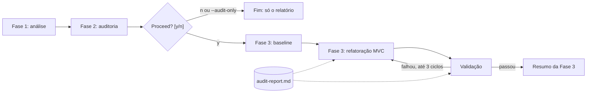

# Refatoração Arquitetural Automatizada com a skill `refactor-arch`

Entrega do desafio **"Criação de Skills — Refatoração Arquitetural Automatizada"** (MBA Engenharia de Software com IA — Full Cycle, módulo *Desenvolvimento de Software e Aplicações com IA*).

Este repositório contém:

- a skill **`refactor-arch`** para **Claude Code**, em `.claude/skills/refactor-arch/` dentro de cada um dos 3 projetos (cópias idênticas);
- o **código refatorado** dos 3 projetos legados, resultado da Fase 3 da skill;
- os **relatórios de auditoria** da Fase 2 em [`reports/`](reports/);
- as **evidências de validação** (boot + comparação de endpoints antes × depois) em [`reports/validation/`](reports/validation/).

> O enunciado original está no repositório base: <https://github.com/devfullcycle/mba-ia-refactor-projects-skill>. O código legado intacto pode ser consultado no commit `6d1ce62`.
>
> Link do exercício na plataforma Full Cycle: <https://plataforma.fullcycle.com.br/courses/a091b0fe-a5c6-4287-a3d3-1ec61defcfd3/413/224/266/conteudos?projeto=70&fase=295>

## Sumário

- [A) Análise Manual](#a-análise-manual)
- [B) Construção da Skill](#b-construção-da-skill)
- [C) Resultados](#c-resultados)
- [D) Como Executar](#d-como-executar)

| Projeto | Stack | Domínio | Achados na auditoria | Endpoints preservados |
|---|---|---|---|---|
| `code-smells-project` | Python 3 + Flask 3.1.1 + sqlite3 | E-commerce (produtos, usuários, pedidos) | 22 (6 C · 5 H · 6 M · 5 L) | 19/19 |
| `ecommerce-api-legacy` | Node.js + Express 4 + sqlite3 | LMS com checkout (cursos, matrículas, pagamentos) | 20 (5 C · 6 H · 5 M · 4 L) | 3/3 |
| `task-manager-api` | Python 3 + Flask 3.0 + Flask-SQLAlchemy | Task Manager (tasks, usuários, categorias) | 18 (4 C · 3 H · 6 M · 5 L) | 22/22 |

---

## A) Análise Manual

Feita **antes** de escrever a skill, lendo todo o código-fonte e subindo cada aplicação original com um smoke test de todos os endpoints (36 requisições no projeto 1, 10 no projeto 2, 43 no projeto 3). Os achados "provados em execução" estão marcados com 🔬.

### Projeto 1 — `code-smells-project` (Python/Flask, API de E-commerce)

| # | Severidade | Problema | Local | Por que importa |
|---|---|---|---|---|
| 1 | CRITICAL | **SQL Injection** em praticamente todas as queries (concatenação de strings) | `models.py:28, 47-50, 57-61, 109-111, 126-129, 279-281, 289-297` … | 🔬 `POST /login` com `email = "' OR 1=1 --"` retornou **200 logado como Admin**; 🔬 criar produto `D'Agua` retornou **500** (`near "Agua": syntax error`). Bypass de autenticação e exfiltração/destruição de dados. |
| 2 | CRITICAL | **Endpoints administrativos sem autenticação**, incluindo execução de **SQL arbitrário** | `app.py:47-57` (`/admin/reset-db`), `app.py:59-78` (`/admin/query`) | 🔬 `POST /admin/query {"sql": "SELECT ..."}` anônimo retornou dados. Qualquer pessoa pode ler senhas, apagar ou dropar o banco. |
| 3 | CRITICAL | **Credenciais hardcoded e vazadas** | `app.py:7` (`SECRET_KEY`), `controllers.py:285-289` (`/health` devolve `secret_key`, `db_path`, `debug`) | 🔬 `GET /health` expõe a chave secreta para qualquer cliente. Segredo versionado no Git, sem rotação por ambiente. |
| 4 | CRITICAL | **Senhas em texto puro** (armazenadas, comparadas no SQL e retornadas pela API) | `database.py:75-83`, `models.py:83, 100, 109-111, 126-129` | 🔬 `GET /usuarios` devolve o campo `senha` de todos os usuários. Um vazamento expõe todas as senhas. |
| 5 | HIGH | **Pseudo-MVC / God module**: `models.py` mistura SQL + regras (estoque, desconto) de 4 domínios; `controllers.py` são views Flask com validação, "notificações" e acesso direto ao banco; `app.py` tem rotas com SQL | `models.py:1-314`, `controllers.py:188-220`, `app.py:47-78` | Nada é testável isoladamente; qualquer mudança afeta tudo (viola SRP). |
| 6 | HIGH | **Estado global mutável**: conexão SQLite única global, compartilhada entre threads | `database.py:4-11` (`global db_connection`, `check_same_thread=False`) | Condições de corrida; o `commit` de uma requisição efetiva a transação inacabada de outra. |
| 7 | HIGH | **Criação de pedido não atômica**: verifica estoque, insere pedido/itens e baixa estoque sem transação | `models.py:133-169` | Pedidos parciais e estoque negativo (oversell) sob concorrência ou erro no meio do fluxo. |
| 8 | HIGH | **`debug=True` + `host=0.0.0.0` hardcoded** | `app.py:8, 88` | O debugger do Werkzeug exposto na rede permite execução remota de código. |
| 9 | MEDIUM | **N+1 queries** na listagem de pedidos (1 + N pedidos + N×M itens) | `models.py:171-233` | O tempo de resposta cresce linearmente com o volume de pedidos. |
| 10 | MEDIUM | **Tratamento de erro repetido e vazando detalhes**: `try/except` em todos os handlers devolvendo `str(e)`; nenhum error handler global | `controllers.py:10-12, 21-22, 60-62…` | Formato de erro inconsistente; mensagens internas vazam para o cliente. |
| 11 | MEDIUM | **Validação ausente/duplicada**: create e update de produto copiados (o update não valida nome nem categoria); `login` sem body gera 500; `preco` sem checagem de tipo | `controllers.py:24-96, 169-170` | Entrada inválida vira 500 ou dado corrompido. |
| 12 | LOW | **Magic numbers**: faixas de desconto `10000/0.1`, `5000/0.05`, `1000/0.02`; listas de status/categorias inline | `models.py:256-262`, `controllers.py:52, 242` | A regra de negócio fica escondida em literais. |
| 13 | LOW | **`print` como log** (inclusive e-mail de usuário em login falho) | `controllers.py:8, 57, 179, 182, 208-210`, `app.py:56` | Sem níveis nem estrutura de log; vaza PII no stdout. |
| 14 | LOW | **Imports não usados e nomes ruins** (`import os`, `import sqlite3` em models; `id` sombreando builtin; `cursor2/cursor3`) | `database.py:2`, `models.py:2`, `controllers.py:56, 160` | Ruído e risco de bugs sutis. |

### Projeto 2 — `ecommerce-api-legacy` (Node.js/Express, LMS com checkout)

| # | Severidade | Problema | Local | Por que importa |
|---|---|---|---|---|
| 1 | CRITICAL | **Credenciais de produção hardcoded** (`dbPass`, `paymentGatewayKey: "pk_live_..."`, `smtpUser`) | `src/utils.js:1-7` | Chave de gateway de pagamento **live** versionada no repositório. |
| 2 | CRITICAL | **God class `AppManager`**: cria o banco, define schema, faz seed, registra rotas, processa pagamento e auditoria | `src/AppManager.js:4-139` | Zero separação de responsabilidades; impossível testar o checkout sem HTTP e banco reais. |
| 3 | CRITICAL | **"Criptografia" caseira de senha** (`badCrypto`: base64 repetido e truncado em 10 caracteres) + senha padrão `"123456"` quando ausente | `src/utils.js:17-23`, `src/AppManager.js:68` | Reversível e com colisões (senhas com o mesmo prefixo geram o mesmo "hash"). |
| 4 | CRITICAL | **Dados sensíveis em log**: número completo do cartão + chave do gateway | `src/AppManager.js:45` | 🔬 O log mostrou `Processando cartão 4111222233334444 na chave pk_live_...`. Violação de PCI-DSS. |
| 5 | HIGH | **Callback hell + checkout não atômico**: matrícula, pagamento e auditoria em 4 níveis de callback, sem transação; o erro da auditoria é ignorado | `src/AppManager.js:37-77` | Uma falha no meio deixa matrícula sem pagamento; o fluxo é ilegível e frágil. |
| 6 | HIGH | **Estado global mutável** (`globalCache`, `totalRevenue` exportados) | `src/utils.js:9-15` | Cache compartilhado e sem controle; vazamento de memória; acoplamento escondido. |
| 7 | HIGH | **Endpoints administrativos/destrutivos sem autenticação e sem integridade referencial** | `src/AppManager.js:80` (relatório financeiro), `:131-137` (`DELETE /api/users/:id`) | 🔬 Após o delete, o relatório mostrou o aluno como `"Unknown"`, com pagamento órfão. Qualquer pessoa vê dados financeiros. |
| 8 | MEDIUM | **N+1 no relatório financeiro** (1 + cursos + 2×matrículas queries) com contadores manuais | `src/AppManager.js:83-128` | 🔬 A ordem dos cursos na resposta **mudou entre duas chamadas** (race dos callbacks). Lento e não determinístico. |
| 9 | MEDIUM | **Tratamento de erro inconsistente**: `err` ignorado em callbacks internos (`enrollments.length` em `undefined` derruba o processo), respostas em texto puro misturadas com JSON | `src/AppManager.js:92, 104, 106, 133` | Erros silenciosos ou crash do servidor; o cliente não tem contrato de erro. |
| 10 | MEDIUM | **Regra de negócio e validação no handler**: "pagamento" simulado por `cc.startsWith("4")`, sem validar e-mail/cartão | `src/AppManager.js:35, 46` | A regra de pagamento fica presa na rota; não dá para trocar por um gateway real. |
| 11 | LOW | **Nomes ruins**: `u, e, p, cid, cc`, campos `usr/eml/pwd/c_id`, `badCrypto`, `AppManager` | `src/AppManager.js:29-33` | Legibilidade e intenção escondidas. |
| 12 | LOW | **Código morto / magic strings**: `totalRevenue` importado e nunca usado, `self = this`, `'PAID'/'DENIED'` literais, `sqlite3.verbose()` em produção | `src/AppManager.js:1-2, 26, 46`, `src/utils.js:10` | Ruído e literais duplicados. |

### Projeto 3 — `task-manager-api` (Python/Flask + SQLAlchemy, Task Manager)

| # | Severidade | Problema | Local | Por que importa |
|---|---|---|---|---|
| 1 | CRITICAL | **Segredos hardcoded**: `SECRET_KEY` e credenciais SMTP | `app.py:13`, `services/notification_service.py:7-10` | Senha de e-mail e chave da aplicação versionadas. |
| 2 | CRITICAL | **Hash de senha com MD5 sem salt** | `models/user.py:27-32` | MD5 é quebrável por rainbow table em segundos. |
| 3 | CRITICAL | **Hash da senha exposto na API** (`to_dict` inclui `password`) | `models/user.py:16-25` → `routes/user_routes.py:33, 85, 129, 209` | 🔬 `POST /users`, `GET /users/1` e `POST /login` devolvem o hash MD5. |
| 4 | HIGH | **Autenticação falsa e nenhuma autorização**: token `'fake-jwt-token-' + id`; qualquer um cria usuário `admin` | `routes/user_routes.py:210, 52-72` | Não há controle de acesso real; escalada de privilégio trivial. |
| 5 | HIGH | **Regra de negócio nas rotas** (validações, cálculo de atraso, estatísticas, relatórios); camada `services/` existe mas não é usada | `routes/task_routes.py:11-299`, `routes/report_routes.py:12-155` | A organização em pastas é só aparente: as rotas são "fat controllers" e não há camada de controller. |
| 6 | HIGH | **`debug=True` hardcoded** | `app.py:34` | Debugger do Werkzeug exposto na rede = RCE. |
| 7 | MEDIUM | **N+1 queries**: `User.query.get`/`Category.query.get` por task, `len(u.tasks)` por usuário, `count` por categoria, 9 `COUNT` separados no summary | `routes/task_routes.py:41-57`, `routes/user_routes.py:22`, `routes/report_routes.py:15-28, 56, 163` | Custo cresce com o número de tasks/usuários. |
| 8 | MEDIUM | **APIs deprecated**: `Query.get()` (legacy no SQLAlchemy 2.x) e `datetime.utcnow()` (deprecated no Python 3.12+) | `routes/*.py` (13 ocorrências de `.query.get`), `models/*.py:14-16`, `routes/task_routes.py:31…` | 🔬 Confirmado com `python -W default`: `LegacyAPIWarning` e `DeprecationWarning`. Vão quebrar em upgrades. |
| 9 | MEDIUM | **Duplicação**: a regra de "atrasada" foi reimplementada 6 vezes, embora `Task.is_overdue()` exista; validação de task duplicada entre create/update; `process_task_data` nunca é usado | `routes/task_routes.py:30-39, 71-80, 283-287`, `routes/user_routes.py:171-180`, `routes/report_routes.py:34-36, 132-135`, `utils/helpers.py:57-108` | As regras divergem com o tempo; cada correção tem de ser feita N vezes. |
| 10 | MEDIUM | **Tratamento de erro**: `except:` sem tipo; nenhum handler global; `PUT /categories/<id>` sem body e `/tasks/search?priority=abc` geram 500 | `routes/task_routes.py:62, 137, 204, 236`, `routes/report_routes.py:196-197`, `routes/task_routes.py:261` | Erros reais são engolidos; entrada inválida vira 500. |
| 11 | LOW | **Imports não usados** (`os, sys, json` em `app.py`; `json, os, sys, time` em `task_routes`; `hashlib, json` em `user_routes`; metade de `helpers.py`) | `app.py:7`, `routes/task_routes.py:7`, `routes/user_routes.py:6`, `utils/helpers.py:2-7` | Ruído e dependências enganosas. |
| 12 | LOW | **Magic numbers e booleanos verbosos**: prioridade `1..5`, senha mínima `4`, listas de status inline; `if x: return True else: return False` | `routes/task_routes.py:110-114`, `routes/user_routes.py:64`, `models/user.py:34-38`, `models/task.py:38-48` | As constantes de `utils/helpers.py:110-116` existem mas não são usadas. |
| 13 | LOW | **`print` como log** | `routes/task_routes.py:149, 219, 234`, `routes/user_routes.py:83, 89, 147` | Sem nível nem estrutura de log. |

---

## B) Construção da Skill

### O fluxo



| Etapa | Lê | Escreve |
| --- | --- | --- |
| Fase 1: análise | `project-analysis.md`, código do projeto | Nada (imprime o resumo da stack) |
| Fase 2: auditoria | `anti-patterns-catalog.md`, `audit-report-template.md`, código | `audit-report.md` (ou `--report <path>`), único arquivo antes do "y" |
| Confirmação | Resposta do usuário | Nada; `n` ou `--audit-only` encerra |
| Fase 3: baseline | `validation-protocol.md`, app original rodando | Status e chaves de cada endpoint |
| Fase 3: refatoração | Relatório, `mvc-guidelines.md`, `refactoring-playbook.md` | Código em camadas MVC |
| Validação | Baseline, app refatorada, relatório | Boot, comparação de endpoints, matriz de autorização, re-scan |

O relatório confirmado é a ordem de serviço da Fase 3: toda Recommendation é implementada por inteiro, e a validação confere cada uma (regra global 4 do `SKILL.md`). A baseline é capturada antes de qualquer mudança, então "a aplicação continua funcionando" vira uma comparação entre o antes e o depois.

### Estrutura

```
.claude/skills/refactor-arch/
├── SKILL.md                              # o "prompt": papel, regras globais e as 3 fases
└── references/
    ├── project-analysis.md               # Fase 1 — heurísticas de linguagem, framework, banco, domínio, arquitetura e inventário de rotas
    ├── anti-patterns-catalog.md          # Fase 2 — 23 anti-patterns (sinais de detecção + severidade) + tabela de APIs deprecated
    ├── audit-report-template.md          # Fase 2 — formato exato do relatório (com exemplo bom × ruim)
    ├── mvc-guidelines.md                 # Fase 3 — camadas, responsabilidades, regra de dependência, árvores-alvo por stack
    ├── refactoring-playbook.md           # Fase 3 — 17 transformações com código antes/depois (Python e JS)
    └── validation-protocol.md            # Fase 3 — baseline, boot, comparação de endpoints, re-scan, limpeza
```

| Área de conhecimento exigida | Arquivo |
|---|---|
| Análise de projeto | `project-analysis.md` |
| Catálogo de anti-patterns | `anti-patterns-catalog.md` |
| Template de relatório | `audit-report-template.md` |
| Guidelines de arquitetura | `mvc-guidelines.md` |
| Playbook de refatoração | `refactoring-playbook.md` |
| *(extra)* Protocolo de validação | `validation-protocol.md` |

### Decisões de design

1. **`SKILL.md` é o roteiro, as referências são o conhecimento.** O `SKILL.md` (~180 linhas) só diz *o que fazer e em que ordem*. Cada fase indica quais arquivos ler naquele momento, o que mantém o contexto enxuto (*progressive disclosure*) e permite evoluir o catálogo sem mexer no fluxo.
2. **Banners fixos de saída** (`PHASE 1: PROJECT ANALYSIS`, `ARCHITECTURE AUDIT REPORT`, `PHASE 3: REFACTORING COMPLETE`) idênticos aos do enunciado. Assim cada execução pode ser comparada lado a lado.
3. **Portão de confirmação explícito.** A regra global 1 proíbe qualquer escrita antes do "y". A única exceção é o próprio arquivo do relatório, que é criado e nunca altera código. O agente usa `AskUserQuestion` quando disponível e, se não estiver, imprime `Proceed with refactoring (Phase 3)? [y/n]` e encerra o turno. `disable-model-invocation: true` impede que a skill seja disparada automaticamente: ela só roda via `/refactor-arch`.
4. **Evidência acima de opinião.** Cada achado exige `arquivo:linha` reaberto antes de ir para o relatório. Um *grep hit* é só candidato e precisa ser confirmado lendo o código. Há *sanity gates* antes de imprimir: contagens batem com o resumo e todo achado tem linha real.
5. **Contrato público como invariante.** As rotas, os campos de request, o envelope de resposta e o comando de execução precisam continuar funcionando. Toda mudança de comportamento tem de ser um conserto de segurança e aparece em *Intentional behavior changes*.
6. **Validação baseada em baseline.** Antes de mudar qualquer arquivo, a Fase 3 sobe a aplicação **original** e grava status + chaves de cada endpoint. Depois da refatoração, repete as mesmas chamadas e compara. Isso transforma "a aplicação continua funcionando" em algo verificável.
7. **Argumentos opcionais**: `--report <path>` (onde salvar o relatório) e `--audit-only` (só Fases 1–2).

### Catálogo de anti-patterns (23 entradas)

| Severidade | ID | Anti-pattern | Por que entrou |
|---|---|---|---|
| CRITICAL | AP-01 | Segredos/credenciais hardcoded | Presente nos 3 projetos (`SECRET_KEY`, `pk_live_…`, senha SMTP) |
| CRITICAL | AP-02 | SQL Injection (concatenação/interpolação) | Projeto 1 inteiro; provado com bypass de login |
| CRITICAL | AP-03 | God Class / God Module | `models.py` (P1) e `AppManager` (P2) |
| CRITICAL | AP-04 | Endpoint administrativo/destrutivo/de privilégio sem proteção | `/admin/query` com SQL arbitrário (P1), relatório financeiro e delete de usuário (P2), criação de admin, troca de `role`/`active` e delete de usuário (P3) |
| CRITICAL | AP-05 | Armazenamento inseguro de senha | Texto puro (P1), base64 caseiro (P2), MD5 (P3) |
| CRITICAL | AP-06 | Exposição de dados sensíveis (respostas e logs) | Senha na API (P1/P3), cartão + chave no log (P2) |
| HIGH | AP-07 | Regra de negócio na camada HTTP (*fat route*) | Os 3 projetos — inclusive o P3 "organizado" |
| HIGH | AP-08 | Acoplamento forte / sem DI / sem composition root | Os 3 projetos |
| HIGH | AP-09 | Estado global mutável | Conexão global (P1), `globalCache` (P2) |
| HIGH | AP-10 | Escrita multi-etapa não atômica / integridade referencial | Pedido (P1), checkout e delete de usuário (P2) |
| HIGH | AP-11 | Callback hell | Específico de Node (P2) — mostra que o catálogo cobre idiomas de cada stack |
| HIGH | AP-12 | Configuração insegura hardcoded (`debug=True`, CORS `*`, token falso) | Os 3 projetos |
| MEDIUM | AP-13 | Queries N+1 | Os 3 projetos |
| MEDIUM | AP-14 | Validação ausente/duplicada | Os 3 projetos (gerando 500 e até crash no P2) |
| MEDIUM | AP-15 | Duplicação (DRY) | Regra de "atrasada" reimplementada 6× no P3 |
| MEDIUM | AP-16 | Tratamento de erro inconsistente / `except:` | Os 3 projetos |
| MEDIUM | AP-17 | **APIs deprecated** — tabela por ecossistema com o equivalente moderno | `Query.get`, `datetime.utcnow` (P3); driver sqlite3 só com callbacks (P2) |
| MEDIUM | AP-18 | Efeitos colaterais/infra no lugar errado | Schema/seed no import, "e-mails" com `print` |
| LOW | AP-19 | Magic numbers/strings | Faixas de desconto, prioridades, status |
| LOW | AP-20 | Nomes ruins | `u, e, p, cc, cid`, `badCrypto` |
| LOW | AP-21 | Imports/código morto | `import os, sys, json` não usados |
| LOW | AP-22 | `print`/`console.log` como log | Os 3 projetos |
| LOW | AP-23 | Condicionais verbosos / código não idiomático | `if x: return True else: return False` |

Cada entrada traz **sinais de detecção acionáveis** (regex de `grep` + o que confirmar lendo o código), o motivo do problema e a transformação do playbook que o corrige. O catálogo termina com um *grep pack* pronto para copiar e colar.

O **playbook** tem 17 transformações (T-01 a T-17), todas com código **antes/depois** em Python e/ou JavaScript: extrair config, parametrizar queries, dividir God class, mover regra para controller, composition root, eliminar estado global, error handler central, eliminar N+1, hash de senha (com upgrade transparente do hash legado), remover dados sensíveis, transações, callback → async/await, substituir APIs deprecated, validação centralizada, constantes, higiene e proteção de endpoints admin.

### Como a skill ficou agnóstica de tecnologia

- **Nada no `SKILL.md` cita Flask, Express ou nomes de arquivo dos projetos.** A Fase 1 detecta a stack, e as referências trazem seções por ecossistema (Python, Node, e uma regra "qualquer outra stack" com o mapeamento para Go/Spring).
- **Heurísticas por sinal, não por nome**: a stack vem do manifesto (`requirements.txt`, `package.json`, `go.mod`…), o banco vem do driver/ORM e o domínio vem de tabelas + rotas + seed.
- **Escala de maturidade arquitetural** (Monolithic / Pseudo-layered / Partially layered / Layered) com uma estratégia de refatoração diferente para cada nível. É isso que permite tratar o monolito do P2 e o projeto já organizado do P3 com a mesma skill.
- **Árvores-alvo por stack** no `mvc-guidelines.md`, com a mesma regra de dependência para todas (`views → controllers → models/services`).
- **Contrato preservado por observação, não por suposição**: o baseline HTTP funciona igual para qualquer stack que exponha HTTP.
- **Prova**: a mesma pasta, copiada byte a byte (`diff -r` sem diferenças), rodou nos 3 projetos.

### Desafios encontrados e como resolvi

| # | Desafio | Solução |
|---|---|---|
| 1 | **Ordenação dentro da mesma severidade.** O template pedia "por arquivo e linha", mas o modelo ordenou por impacto, o que é mais útil para quem lê | O template passou a pedir "maior impacto primeiro; empate por arquivo/linha" |
| 2 | **Auditoria e refatoração desalinhadas (feedback da correção).** Na 1ª entrega, o AP-04 do P3 recomendava guarda para criação de admin, troca de role e `DELETE` de usuário, mas a Fase 3 só bloqueou a autoatribuição de admin. `DELETE /users/<id>` e a troca de `active` ficaram sem guarda. A causa era uma regra minha (commit `d890df6`) que limitava guards a rotas `/admin/*` para não quebrar o contrato, ou seja, a Fase 3 estreitava a recomendação em silêncio | Correção no commit `3ada4b7`: **(a)** regra global 4: o relatório é a ordem de serviço da Fase 3, e toda Recommendation é implementada por inteiro; decisões de escopo acontecem na Fase 2, nunca na 3. **(b)** regra global 5: a Recommendation do AP-04 lista cada operação guardada como `METHOD /path` + condição, e criação de conta privilegiada, troca de `role`/`active` e exclusão de usuário estão sempre no escopo. **(c)** T-17 reescrito com 17-A (token estático para `/admin/*`) e 17-B (token assinado no login + `require_auth`/`require_role` + guarda condicional por campo). **(d)** Tabela de conformidade no plano, checagem de conformidade na validação e **matriz de autorização** obrigatória (anônimo → 401, comum → 403, admin → sucesso). Depois disso, **rodei a skill de novo no `task-manager-api` a partir do código legado** (commit `6d1ce62`). P1 e P2 já estavam conformes: as guardas implementadas cobrem exatamente o que seus relatórios recomendam |
| 3 | **Account takeover pela troca de senha (2º feedback da correção).** Na 2ª entrega, a regra 5 cobria `role`, `active`, criação de admin e `DELETE`, mas não credenciais. O `PUT /users/<id>` com `password` ficou público: qualquer pessoa trocava a senha do admin `joao@email.com`, fazia login e recebia um token de admin. Ou seja, a mesma escalada de privilégio por outro caminho | **(a)** Regra global 5: troca de `password`/`email` (ou outro identificador de login) de uma conta existente entra sempre no escopo do AP-04, com guarda *owner-or-admin* (só o próprio usuário ou um admin). Antes de escrever a Recommendation, a skill percorre todo campo gravável das rotas de usuário. **(b)** AP-04 no catálogo ganhou o sinal "account takeover" e a linha `PUT /users/<id>` com `password`/`email` → dono ou admin no exemplo obrigatório. **(c)** T-17 ganhou `CREDENTIAL_FIELDS` no controller (Python) e `requireSelfOrRole` (Node), e a matriz passou a ter as colunas "outro usuário" e "o próprio usuário". **(d)** A validação reproduz a cadeia de takeover (trocar a senha do admin e tentar logar com ela) e exige que falhe. Rodei a skill de novo no `task-manager-api` a partir do código legado. P1 e P2 não têm rota que altere senha/e-mail de outra conta, então continuam conformes |
| 4 | **Falso positivo.** Na auditoria do P3, a skill marcou AP-10 (FK órfã ao apagar categoria) | O baseline da Fase 3 mostrou que o backref do SQLAlchemy já zera `category_id`. Na 1ª execução, a skill retirou o achado. Na 2ª, pela regra 4, manteve o achado com uma **nota de correção datada** (a severidade efetiva cai para LOW) e implementou a Recommendation mesmo assim (anulação explícita da FK na mesma transação). Na 3ª, a skill confirmou o comportamento ainda na Fase 2 e listou o AP-10 como "avaliado e não aplicável", com o motivo. É o lugar certo para essa decisão: a regra 4 manda decidir escopo na Fase 2 |
| 5 | **Servidor zumbi na validação.** O reloader do Flask em `debug=True` deixa um processo filho segurando a porta depois do `pkill` | O `validation-protocol.md` manda encerrar **por porta** (`lsof -tiTCP:<port>`), nunca por nome de processo |
| 6 | **Execução headless.** Rodei a skill de verdade via `claude -p` (ver seção D). Uma regra `Write(path)` em `--allowedTools` não cobre escrita de arquivo (precisa ser `Edit(path)`) | Uso de `--permission-mode acceptEdits` + allowlist de comandos Bash; a confirmação da Fase 2 é dada com `claude -p -c "y"` |
| 7 | **Skill atualizada no meio de uma sessão.** A sessão continuada do P3 tinha carregado o `SKILL.md` antigo | A resposta de confirmação pediu para reler o `SKILL.md` antes da Fase 3 |
| 8 | **Bugs que eu não tinha visto.** A skill achou um crash que escapou da minha análise manual: no P2, `"card": 4111` (número em vez de string) derruba o processo inteiro (`cc.startsWith is not a function`) | Classificado como AP-14 elevado para HIGH, e corrigido na Fase 3 (agora retorna 400) |

---

## C) Resultados

### Resumo das auditorias (Fase 2)

| Projeto | CRITICAL | HIGH | MEDIUM | LOW | Total | APIs deprecated | Relatório |
|---|---|---|---|---|---|---|---|
| 1 — code-smells-project | 6 | 5 | 6 | 5 | **22** | nenhuma (verificado com `python -W default`) | [audit-project-1.md](reports/audit-project-1.md) |
| 2 — ecommerce-api-legacy | 5 | 6 | 5 | 4 | **20** | driver sqlite3 só com callbacks; `.verbose()` em produção | [audit-project-2.md](reports/audit-project-2.md) |
| 3 — task-manager-api | 4 | 3 | 6 | 5 | **18** | `Query.get()` (16×), `datetime.utcnow()` (20+×) | [audit-project-3.md](reports/audit-project-3.md) |

**Cobertura da análise manual**: todos os problemas da seção A aparecem nos relatórios da skill (14/14 no P1, 12/12 no P2, 13/13 no P3), bem acima do mínimo de 5 por projeto. A skill ainda achou problemas extras, como o crash do P2 com cartão numérico, o oversell por quantidade negativa no P1 e a ausência de devolução de estoque no cancelamento.

### Estrutura antes × depois

**Projeto 1 — code-smells-project** (Pseudo-layered → MVC)

```
ANTES                         DEPOIS
app.py        (rotas + SQL)   app.py                        # entry point: python app.py
controllers.py (views+regra)  src/
models.py     (SQL + regra)   ├── app.py                    # create_app(): composition root
database.py   (conn global)   ├── config/settings.py        # env vars (.env.example)
                              ├── models/      database · produto · usuario · pedido · relatorio · admin
                              ├── controllers/ errors · validators · produto · usuario · pedido · relatorio · sistema · admin
                              ├── views/       produto · usuario · pedido · relatorio · sistema · admin (Blueprints)
                              ├── services/    notification_service · password_hasher
                              └── middlewares/ error_handler · auth (X-Admin-Token)
4 arquivos · ~780 linhas      34 arquivos · ~1.190 linhas
```

**Projeto 2 — ecommerce-api-legacy** (Monolithic → MVC)

```
ANTES                         DEPOIS
src/app.js                    src/app.js                    # createApp(): composition root + listen
src/AppManager.js (God class) src/config/index.js
src/utils.js (config+cache    src/models/      database (promisified + transações) · seed · user · course · enrollment · payment · auditLog · financialReport
              +"crypto")      src/controllers/ errors · validators · checkout · financialReport · user
                              src/routes/      checkout · admin · user (Express Routers)
                              src/views/       checkoutView · financialReportView
                              src/services/    paymentGateway · passwordHasher (scrypt) · logger
                              src/middlewares/ errorHandler · asyncHandler · adminAuth
3 arquivos · ~180 linhas      26 arquivos · ~660 linhas
```

**Projeto 3 — task-manager-api** (Partially layered → MVC)

```
ANTES                         DEPOIS
app.py (config hardcoded)     app.py                        # entry point; reexporta app, db (compatível com seed.py)
database.py                   seed.py                       # usa create_app()
seed.py                       src/
models/  task · user · category ├── app.py                  # create_app()
routes/  task · user · report   ├── config/settings.py
         (fat routes)           ├── models/      database (utcnow) · constants · task · user · category
services/ notification (não     ├── controllers/ errors · validators · metrics · task · user · category · report   ← camada que faltava
          usado, senha SMTP)    ├── views/       presenters · task · user · category · report · system
utils/   helpers (meio morto)   ├── services/    token_service (itsdangerous) · notification_service
                                └── middlewares/ error_handler (JSON) · auth (Bearer)
15 arquivos · ~1.160 linhas   31 arquivos · ~1.350 linhas em src/
```

### Validação independente (fora da skill)

Além da validação que a própria skill faz, rodei meu próprio smoke test HTTP (stdlib, ~70 linhas). Ele envia a mesma lista de requisições ao app **original** e ao **refatorado**, sempre com banco recém-criado. Tabelas completas e logs de boot em [`reports/validation/`](reports/validation/).

| Projeto | Requisições | Iguais ao baseline | Mudanças intencionais (segurança) | Verificações novas | 5xx depois |
|---|---|---|---|---|---|
| 1 | 39 | 33 | 3: bypass de login por SQLi 200→**401**; `D'Agua` 500→**201**; `/admin/query` anônimo 200→**403** | 3 | **0** (antes: 1) |
| 2 | 13 | 10 | relatório/delete exigem `X-Admin-Token` | 3 (incl. crash do cartão numérico → 400) | **0** |
| 3 | 58 | 41 | 17: matriz de autorização (criação de admin, troca de `role`/`active` e `DELETE` de usuário → só admin; troca de `password`/`email` → só o dono ou admin; **401** anônimo / **403** sem permissão) e a cadeia de account takeover do admin bloqueada | — | **0** |

Trecho do log de boot do projeto 3 refatorado, rodando com `-W default` e **sem nenhum `DeprecationWarning`/`LegacyAPIWarning`**, que antes apareciam:

```
$ python seed.py && python -W default app.py
Seed concluído com sucesso!
  3 usuários
  4 categorias
  10 tasks
WARNING src.config.settings: SECRET_KEY not set; using a random ephemeral key (tokens expire on restart)
 * Serving Flask app 'src.app'
 * Debug mode: off
 * Running on http://127.0.0.1:5000
INFO src.controllers.task_controller: Task criada id=11
```

Log do projeto 2: o cartão aparece mascarado e a chave do gateway não aparece mais:

```
INFO LMS API rodando na porta 3000
INFO Processando pagamento de 497 no cartão ****4444
INFO Checkout concluído: curso=2 usuario=2 matricula=2
INFO Usuário 1 removido com matrículas e pagamentos
```

### Checklist de validação

| Item | P1 code-smells | P2 ecommerce-legacy | P3 task-manager |
|---|---|---|---|
| **Fase 1 — Análise** | | | |
| Linguagem detectada corretamente | ✅ Python | ✅ JavaScript (Node.js) | ✅ Python |
| Framework detectado corretamente | ✅ Flask 3.1.1 | ✅ Express ^4.18.2 (4.22.1 instalado) | ✅ Flask 3.0.0 + Flask-SQLAlchemy 3.1.1 |
| Domínio descrito corretamente | ✅ E-commerce | ✅ LMS com checkout | ✅ Task Manager |
| Nº de arquivos condiz com a realidade | ✅ 4 | ✅ 3 | ✅ 15 |
| **Fase 2 — Auditoria** | | | |
| Relatório segue o template | ✅ | ✅ | ✅ |
| Cada finding tem arquivo e linhas exatos | ✅ | ✅ | ✅ |
| Ordenado CRITICAL → LOW | ✅ | ✅ | ✅ |
| Mínimo de 5 findings | ✅ 22 | ✅ 20 | ✅ 18 |
| APIs deprecated (se aplicável) | ✅ verificado; nenhuma | ✅ 2 itens | ✅ 2 APIs, todas as ocorrências |
| Pausa e pede confirmação antes da Fase 3 | ✅ | ✅ | ✅ |
| **Fase 3 — Refatoração** | | | |
| Estrutura de diretórios segue MVC | ✅ | ✅ | ✅ |
| Config extraída (sem hardcoded) | ✅ `src/config/settings.py` + `.env.example` | ✅ `src/config/index.js` + `.env.example` | ✅ `src/config/settings.py` + `.env.example` |
| Models abstraem os dados | ✅ repositórios por entidade | ✅ 7 models | ✅ entidades + repositórios |
| Views/Routes separadas | ✅ `src/views/` | ✅ `src/routes/` + `src/views/` | ✅ `src/views/` |
| Controllers concentram o fluxo | ✅ sem import de Flask | ✅ sem import de Express | ✅ camada criada do zero |
| Error handling centralizado | ✅ `middlewares/error_handler.py` | ✅ `middlewares/errorHandler.js` | ✅ `middlewares/error_handler.py` |
| Entry point claro | ✅ `python app.py` | ✅ `npm start` | ✅ `python app.py` |
| Aplicação inicia sem erros | ✅ | ✅ | ✅ |
| Endpoints originais respondem | ✅ 19/19 | ✅ 3/3 | ✅ 22/22 |

**Critérios de aceite**: Fase 1 detecta a stack (3/3) · Fase 2 com ≥ 5 findings (3/3) · ≥ 1 CRITICAL/HIGH (3/3) · aplicação funciona após a refatoração (3/3).

### Como a skill se comportou em cada stack

- **Projeto 1 (Flask, pseudo-MVC):** a skill não se deixou enganar pelos nomes `models.py`/`controllers.py`. Classificou o projeto como *Pseudo-layered* porque `controllers.py` eram views Flask e `models.py` continha regras. Fez a divisão completa em 34 arquivos e corrigiu a injeção sem mudar nenhum envelope de resposta.
- **Projeto 2 (Express, monolito):** aplicou os itens específicos de Node: AP-11 (callback hell → `async/await` sobre um wrapper promisificado) e transações serializadas, já que o sqlite3 compartilha uma única conexão. Manteve o formato de erro em **texto puro** do legado, conforme a regra "preserve o envelope existente", em vez de impor JSON.
- **Projeto 3 (Flask, parcialmente organizado):** reconheceu a organização existente (*Partially layered*) e criou o que faltava: a **camada de controllers**, config, middlewares e composition root. Também consolidou `utils/helpers.py` (meio morto) em `validators.py`. Foi o projeto em que a skill mais precisou ponderar segurança × contrato. Depois de cada feedback da correção, foi re-executado do zero a partir do código legado. Na 3ª execução, a matriz de autorização cobre 4 operações guardadas (criação de admin/manager, `role`/`active`, `password`/`email` só pelo dono ou admin, `DELETE`), e a tentativa de sequestrar a conta do admin falha. O CRUD de tasks/categorias e a troca só de `name` continuaram públicos, como o relatório especifica.
- **Ponto comum:** nos 3 casos a skill subiu o app original para tirar um baseline antes de tocar no código, e se recusou a declarar ✓ sem ter observado o resultado.

---

## D) Como Executar

### Pré-requisitos

- **Claude Code** instalado e autenticado (`npm install -g @anthropic-ai/claude-code`, depois `claude` para fazer login). Testado com a versão 2.1.x.
- **Python 3.10+** e `pip` (projetos 1 e 3). Testado com 3.14.
- **Node.js 18+** e `npm` (projeto 2). Testado com 22.x.
- `curl` e `lsof`, usados pela skill na validação.

### Executar a skill

A skill já está em `.claude/skills/refactor-arch/` dentro de cada projeto. Abra o Claude Code **dentro da pasta do projeto**:

```bash
# Projeto 1
cd code-smells-project
python3 -m venv .venv && .venv/bin/pip install -r requirements.txt   # para a validação
claude "/refactor-arch"
#   → Fase 1 (resumo) → Fase 2 (relatório + "Proceed with refactoring (Phase 3)? [y/n]") → responda y → Fase 3

# Projeto 2
cd ../ecommerce-api-legacy
npm install
claude "/refactor-arch"

# Projeto 3
cd ../task-manager-api
python3 -m venv .venv && .venv/bin/pip install -r requirements.txt
claude "/refactor-arch"
```

Opções: `/refactor-arch --audit-only` (só Fases 1–2) e `/refactor-arch --report ../reports/audit-project-1.md` (escolhe onde salvar o relatório).

**Modo headless** (foi assim que gerei os resultados deste repositório):

```bash
claude -p "/refactor-arch --report audit-report.md" --permission-mode acceptEdits --allowedTools "Read" "Glob" "Grep" "Edit" "Write" "Bash(curl:*)" "Bash(lsof:*)" "Bash(kill:*)" "Bash(.venv/bin/python:*)" "Bash(npm:*)" "Bash(node:*)" ...
#   ...termina na pergunta da Fase 2; revise audit-report.md e então:
claude -p -c "y" --permission-mode acceptEdits --allowedTools ...
```

> Para rodar a skill de novo sobre o código **legado**, restaure o projeto a partir do commit original, por exemplo `git checkout 6d1ce62 -- code-smells-project`, e copie a pasta `.claude/skills/refactor-arch/` de volta.

### Validar que a refatoração funcionou

```bash
# Projeto 1 — http://localhost:5000
cd code-smells-project && ADMIN_TOKEN=troque-me .venv/bin/python app.py
curl -s localhost:5000/health
curl -s localhost:5000/produtos | head -c 200
curl -s -X POST localhost:5000/login -H 'Content-Type: application/json' -d '{"email":"admin@loja.com","senha":"admin123"}'
curl -s -X POST localhost:5000/login -H 'Content-Type: application/json' -d "{\"email\":\"' OR 1=1 --\",\"senha\":\"x\"}"   # → 401

# Projeto 2 — http://localhost:3000 (exemplos também em api.http)
cd ecommerce-api-legacy && ADMIN_TOKEN=troque-me npm start
curl -s -X POST localhost:3000/api/checkout -H 'Content-Type: application/json' \
  -d '{"usr":"Ana","eml":"ana@x.com","pwd":"segredo","c_id":2,"card":"4111222233334444"}'
curl -s localhost:3000/api/admin/financial-report -H 'X-Admin-Token: troque-me'

# Projeto 3 — http://localhost:5000
cd task-manager-api && .venv/bin/python seed.py && .venv/bin/python app.py
curl -s localhost:5000/tasks | head -c 200
curl -s localhost:5000/reports/summary | head -c 200
TOKEN=$(curl -s -X POST localhost:5000/login -H 'Content-Type: application/json' -d '{"email":"joao@email.com","password":"1234"}' | python3 -c 'import sys,json;print(json.load(sys.stdin)["token"])')
curl -s -o /dev/null -w '%{http_code}\n' -X DELETE localhost:5000/users/3                                   # → 401 (sem token)
curl -s -o /dev/null -w '%{http_code}\n' -X DELETE localhost:5000/users/3 -H "Authorization: Bearer $TOKEN"  # → 200 (admin)
curl -s -o /dev/null -w '%{http_code}\n' -X PUT localhost:5000/users/1 -H 'Content-Type: application/json' -d '{"password":"hacked"}'  # → 401 (ninguém troca a senha do admin)
```

Variáveis de ambiente de cada projeto (todas opcionais em desenvolvimento) estão documentadas no `.env.example` e no `README.md` de cada pasta. As mais importantes são `SECRET_KEY`, `ADMIN_TOKEN`, `PORT`/`HOST`, `FLASK_DEBUG` e `PAYMENT_GATEWAY_KEY`.

O que conferir:
1. o servidor sobe sem traceback;
2. as rotas listadas na seção *Endpoint contract* de cada relatório respondem com os mesmos status do original (ver [`reports/validation/`](reports/validation/));
3. os probes de segurança agora falham: injeção → 401/0 resultados, admin sem token → 403, nenhum campo de senha nas respostas;
4. no P3, cada operação guardada segue a matriz anônimo → 401 / sem permissão → 403 / admin (e o dono, na troca de senha/e-mail) → sucesso (ver [`reports/validation/project-3.md`](reports/validation/project-3.md)).
